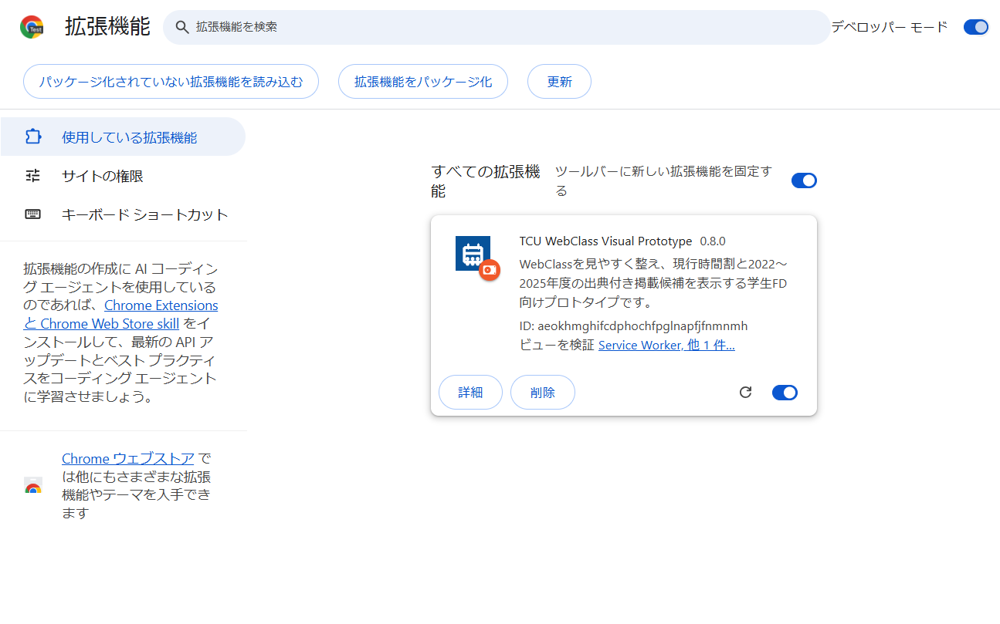

# TCU WebClass Visual Prototype — v0.9.0 リリース候補

東京都市大学のWebClassコースリスト画面を、元の機能を壊さずに読みやすくするChrome／Edge向けManifest V3拡張機能です。

**公開版:** [GitHub Releases](https://github.com/CYLIU2003/tcu-webclass-visual-theme-aware/releases/latest) ／ [画像付き導入ガイド（Web）](https://cyliu2003.github.io/tcu-webclass-visual-theme-aware/) ／ [同梱ガイド](はじめにお読みください.html)

v0.9.0-rc.1 では、「標準／モダン」をポップアップまたはコース一覧の表示オプションから切り替えられます。

本拡張は学生制作の非公式ツールです。時間割・履修資料の全件照合は未完了で、科目カタログ監査は `NOT_READY_FOR_RELEASE`、年度横断DB監査は `extensionReady=false` です。表示は参考情報として、最新の教室・履修・卒業要件は大学の公式情報で確認してください。

設定画面で対象を選択すると、一部の科目について同名の履修資料があることを表示します。表示は科目名による資料案内で、対象の開講科目と資料の科目が同一とは限りません。開講との対応や訂正表は未確認で、卒業・免許・プログラム修了を判定できません。詳細は [履修区分候補の試行データ](docs/CURRICULUM_CANDIDATE_PILOT.md) を参照してください。

## v0.8.0の変更

- コース内の教材種別・操作欄・キーボード操作時の表示を改善
- 入学年度や課程を選び、同名の学科・ひらめき・教職資料がある科目から原資料を参照可能にする。履修区分の確定判定は行わない
- 画面表示を戻す際に元のWebClass要素とイベントを保持し、ZIPで設定の記入例を開けない問題を修正
- 同名の異なるコースに課題がある場合、課題一覧にコースIDを添えて区別

2026年度の全学部・全研究科時間割データとWebClass上の講義コードを照合し、**担当教員、教室、曜日・時限、キャンパス、学科・研究科**を表示します。学生FDにおける改善提案・実証用のプロトタイプであり、WebClass本体のデータや通信内容は変更しません。

> **データ状態:** 2026年度の3,736科目は公開資料から作った調査用スナップショットで、リアルタイム更新ではありません。過年度は2022〜2025年度の公式PDF 7資料から抽出した13,202行を候補として収録し、うち23行を目視確認しています。未確認行は候補と明示し、出典PDFを開けます。2026年度の学修要覧などへのリンク・ページ索引はありますが、履修・卒業要件の構造化データは未登録です。
>
> GitHubの拡張機能リポジトリには出典情報付きの実行用候補データと検証資料を収録します。年度横断SQLiteと原PDFキャッシュは含めません。

## v0.7.1の変更

- 実際のWebClass教材一覧に合わせ、章・教材名・種別の区切りを改善
- WindowsとMacの導入・更新手順を拡充

## v0.7.0の変更

- 2022〜2025年度の公式時間割PDF 7資料から抽出した13,202行を、出典・ページ・講義コードとともに詳細表示（目視確認済み23行と未確認の抽出候補13,179行を別ラベルで区別）
- 2026年度後期・通年の公式時間割PDF 6資料から抽出した4,360行（集約2,053行、目視確認済み12行）を出典PDFページ付きで区別表示。旧2,556科目スナップショットとの照合では1,186組が未収録だった
- 2026年度の公式時間割訂正表PDF 4資料から抽出した69件の訂正イベント候補（自動未適用）を、時間割カード・補助チップ・授業詳細カードに警告バッジ＋訂正表PDF直リンク付きで表示
- 2026年度の公式履修要覧PDF 11冊（計1,026頁・用語索引1,030件）および大学院教育課程表PDF 3資料の関連ページ案内リンクを授業詳細カードに追加（確定した卒業要件データの登録は0件と明示）
- 過年度候補の絞り込みフィルタバー（同一コード／同名・別コード／目視確認済み／年度別）と、右下「授業情報」パネルでの4層データベース横断検索（基本スナップショット・訂正表候補・2026後期PDF候補・過年度PDF候補）を追加
- 同名・別コードの授業を統合せず、担当教員や教室の異なる記録を個別に表示
- ポップアップと設定画面に全データ層の範囲と確認状態を表示
- 添付の修正版から締切取得・時間割・教材画面の修正を統合。狭い画面の見出しと教材リンクの折り返しを改善し、教室名の重複表示を修正

## v0.4.0の変更（デザイン・使いやすさ）

- 拡張機能アイコンのポップアップを刷新。状態を色とアイコンで表示し、右上の大きなスイッチでON/OFF
- WebClass以外のページでは「はじめかた3ステップ」、未読み込み時は「タブを更新」ボタンを表示
- 設定画面を「基本」「表示のカスタマイズ」「上級者向け」に整理し、自動保存を明示
- ダークモード対応、文字サイズ拡大、キーボード操作のフォーカス表示
- 教材一覧を読みやすく再設計し、コースリストは時間割を先頭に配置
- 初回だけ画面内に案内を表示（そのまま「元の画面に戻す」も可能）
- インストール直後に「はじめかた」ページを自動表示（`src/welcome.html`）
- 誰でも導入できる単体ガイド `はじめにお読みください.html` を追加

## v0.3.0の主な変更

今回提供された実際のWebClassコースリストHTMLに合わせ、単なる別画面の追加ではなく、**既存画面そのものを整える方式**へ変更しました。

- WebClassの既存時間割 `#schedule-table` をその場でカード表示へ変換
- 科目名から年度・曜日・担当者・講義コードの長い付記を除き、正式科目名を大きく表示
- 各カードに「教室」「担当教員」を常時表示
- 新着メッセージと締切間近の状態を小さなバッジに整理
- お知らせ、左メニュー、表示学期、その他のコース一覧をカード型レイアウトへ整理
- 左側へ実際に操作できる「表示オプション」と「授業カテゴリ」凡例を追加
- WebClassで選択されている上部帯の色を読み取り、アクセント色へ自動反映
- 独立した補助時間割は初期状態でオフにし、元の時間割を主表示に変更
- WebClassのURLに含まれる `26smaa030081` のような表記から講義コードを直接抽出
- 教室コードが規則的な場合、`12K` を「1号館2階・12K」のように補足表示
- 表示を無効化した場合に、元のHTMLへ復元する処理を追加

## 対応した実画面要素

実HTMLに存在する次の要素を対象にしています。

```text
header .navbar                上部ナビゲーション
#UserTopInfo                  管理者からのお知らせ
.side-block                   左側メニュー
h3.page-header                参加しているコース
form[name="condition"]       年度・学期・時間割・その他のコース
#schedule-table               PC向け時間割
.schedule-list                スマートフォン向け時間割
.courseTree / .courseList     その他のコース一覧
```

DOM構造に依存しすぎないよう、該当要素がないページでは処理をスキップします。

## 収録データ

2026年度のアップロード済み時間割資料を統合しています。

| 項目 | 収録数 |
|---|---:|
| 時間割資料（時間表12PDF＋変更一覧6PDF） | 18資料 |
| 解析対象ページ | 196頁 |
| PDF上の授業掲載 | 10,077件 |
| 講義コード単位 | 3,736科目 |
| 学科・研究科ラベル | 22種類 |

世田谷キャンパス、横浜キャンパス、渋谷サテライト、通常時限、共同原子力専攻の専用時限、9:00開始科目、集中講義・卒業研究・特別研究を保持しています。

過年度の候補は7資料から抽出した13,202行で、年度別には2022年度3,062行、2023年度2,872行、2024年度3,131行、2025年度4,137行です。このうち23行を目視確認し、残る13,179行はPDF抽出候補として明確に区別しています。全件確認済みの過年度カタログではありません。講義コードが同じでも年度間の科目継続を確定せず、同名・別コードも別々に表示します。担当教員・教室・曜日時限を利用する場合は公式PDFで確認してください。履修要覧の科目区分・単位・卒業要件はまだ拡張に登録していません。

詳細は [`docs/DATA_COVERAGE.md`](docs/DATA_COVERAGE.md) を参照してください。

### 過年度データと将来の履修支援

2022〜2025年度の公式時間割ページ、時間割・訂正資料の所在と、入学年度別の学修要覧アーカイブを登録しています。拡張の授業詳細では、保存した公式PDFから抽出した13,202行を出典付き候補として参照できます。過年度の全候補を確定データとして検索する仕組みではありません。拡張との連携手順は [`docs/EXTENSION_DATABASE_INTEGRATION.md`](docs/EXTENSION_DATABASE_INTEGRATION.md)、履修要覧モデルは [`docs/CURRICULUM_DATABASE_DESIGN.md`](docs/CURRICULUM_DATABASE_DESIGN.md) を参照してください。

将来の履修支援では、開講年度ごとの科目情報と、入学年度・学科ごとの卒業要件を別管理します。履修者の進捗情報は公開科目カタログと分離する設計です。

## 表示機能

1. 元の時間割を、科目別のカード表示へ変換
2. 教室、担当教員、キャンパス、新着、締切状態を表示
3. その他のコースに、担当教員・教室・曜日時限の補助バッジを追加
4. コース画面上部へ「授業基本情報」カードを追加
5. 右下の「授業情報」パネル
6. 任意で独立した週間時間割を追加
7. キャンパス、学科・研究科、講義コード、出典ページを表示
8. ローカルJSONによる科目情報の上書き

## テーマ色への追従

WebClassでは上部帯の配色を設定で変更できます。本拡張機能は、画面を加工する前に現在のナビゲーション色を取得し、次の箇所へ反映します。

- 上部ナビゲーション
- リンク色
- 現在曜日
- お知らせ見出し
- 左側のスイッチ
- ボタンと補助パネル

科目分類色は識別性を優先し、専門科目＝青、基礎科目＝緑、実験・演習＝紫、情報・通信＝橙で固定しています。

## 照合方式

1. **講義コードを最優先**します。
2. WebClassのリンクURL、リンク文字列、HTML属性から講義コードを抽出します。
3. 講義コードがない場合、科目名をNFKC正規化し、年度・学期・曜日時限の表示差を除去します。
4. 学期、曜日時限、担当者、クラス情報で候補を絞ります。
5. 同名科目が残る場合は一件へ決め打ちせず、候補表示にします。

## 教室表示

時間割資料に記載された教室情報を基準にします。単純な教室コードは次のように補足します。

```text
12K → 1号館2階・12K
31A → 3号館1階・31A
1BL → 1号館地下・1BL
```

PBL教室、実験室、各研究室、体育施設、渋谷サテライトなどは、資料上の名称をそのまま表示します。大学側へ正式提案する場合は、正規の教室マスタとの連携が必要です。

## インストール（初めての方へ）

> **いちばん簡単な方法：** 同梱の [`はじめにお読みください.html`](はじめにお読みください.html) をダブルクリックしてください。画面の案内どおりに進めば約3分で完了します。ここでは要点だけ載せます。

**必要なもの：** パソコン、Google Chrome または Microsoft Edge、このZIPファイル

| 手順 | やること |
|---|---|
| 1 | **Windows：** ZIPを右クリック →「すべて展開」。**Mac：** ZIPをダブルクリック。`manifest.json` が直下にあるフォルダーを確認し、削除・移動しない |
| 2 | アドレス欄に `chrome://extensions`（Edgeは `edge://extensions`）と入力して Enter |
| 3 | 右上（Edgeは左下）の **「デベロッパーモード」をオン** |
| 4 | **「パッケージ化されていない拡張機能を読み込む」** → `manifest.json` が直下に見える、いちばん内側のフォルダーを選択（Chrome／Edge共通） |
| 5 | WebClassを開き、**コースリスト**を表示（開いていたタブは Windows `Ctrl + R`、Mac `⌘ + R` で更新） |



上の画面例では、右上のデベロッパーモードをオンにし、左上の「パッケージ化されていない拡張機能を読み込む」を押します。画面右側のカードは読み込み後の例です。Edgeでは表示位置が異なります。

インストール直後には「はじめかた」ページが自動で開きます。ツールバーの 🧩 →📌 でピン留めすると、いつでもスイッチを操作できます。

**キーボード操作：** WebClassの再読み込みは Windows なら `Ctrl + R` または `F5`、Mac なら `⌘ + R`。アドレス欄に移動するには Windows は `Ctrl + L`、Mac は `⌘ + L`。

**更新と設定の引き継ぎ：** 先に設定画面の「上級者向け：時間割データの上書き」から「書き出す」でJSONを保存し、表示スイッチの状態も控えます。新しいZIPを展開したら拡張機能ページで旧版をオフにしてから、新版フォルダーを読み込みます。新版を有効にし、書き出したJSONを設定画面で検証・保存して表示設定を戻してください。動作を確認してから旧版を削除します。ブラウザーや拡張機能IDが変わると設定は自動で移らないため、確認前に旧版を削除しないでください。

**うまくいかないとき**（詳しくは案内ページの「困ったとき」）

- 「マニフェスト ファイルがありません」→ フォルダーが一つ外側です。`manifest.json` が直接入っているフォルダーを選ぶ
- 表示が変わらない → WebClassのタブを F5 で更新、コースリスト画面か確認、アイコンのスイッチがオンか確認
- 「デベロッパーモードの拡張機能を無効に…」→ ×で閉じてそのまま使えます
- 元に戻したい → アイコンのスイッチをオフ（完全削除は拡張機能ページの「削除」）

## プレビュー

- `demo/preview-live-dom-standalone.html`  
  提供された実HTML構造を個人情報・セッショントークン除去後に再現し、本拡張機能を適用した単体プレビューです。ブラウザーで直接開けます。
- `demo/preview-standalone.html`  
  全学科データの代表例を切り替えて確認する従来プレビューです。

## 詳細設定

拡張機能のアイコンまたは左側の表示オプションから、次を切り替えられます。

- 拡張機能全体
- 画面全体の整形
- 元の時間割のカード化
- その他のコースへの補助情報
- 独立した補助時間割
- 左側の表示オプション
- 右下の授業情報パネル
- 出典ラベル

## データ上書き

「詳細設定」で次の形式を保存できます。

```json
{
  "courses": [
    {
      "courseName": "パワーエレクトロニクス特論",
      "courseCode": "smaa030081",
      "aliases": ["パワエレ特論"],
      "instructors": ["鈴木 憲吏"],
      "meetings": [
        {"day": "月", "period": 2, "room": "12K"},
        {"day": "木", "period": 2, "room": "12K"}
      ]
    }
  ]
}
```

講義コードが一致するデータを優先して置換します。

## 検証

以下を実施しています。

- Manifest V3・対象ホスト検査
- 3,736講義コードの一意性検査
- 10,077掲載データの整合性検査
- JavaScript構文検査
- 科目名正規化テスト
- 提供された実HTMLスナップショットに対するDOM統合テスト
- 8履修科目・12時間割セルのカード化確認
- パワーエレクトロニクス特論、電力システム工学特論、情報理論特論の教室・担当者照合
- 表示オン／オフ時の元HTML復元テスト
- 画面への追加DOM発生後に重複カードが生じないことの確認
- 紫・青・緑の上部帯に対するテーマ追従確認

## 制約

- 認証済みWebClass本番環境への直接アクセスは行っていません。提供された実HTMLスナップショットを基準に実装・検証しています。
- WebClass側のバージョン更新でDOM構造が変わった場合は、セレクター調整が必要です。
- 時間割データは2026年度PDFのスナップショットで、リアルタイム更新ではありません。
- 休講、教室変更、オンライン切替、担当変更はWebClassのお知らせを優先してください。
- 固定曜日・時限を持たない集中講義・研究科目は、通常の週間表へ無理に配置しません。

## セキュリティ

- 対象ホストは `https://webclass.tcu.ac.jp/*` のみ
- 拡張機能から外部サーバーへのデータ送信なし
- WebClass画面から時間割の科目情報、および締切一覧用の教材名・締切・状態を読み取る
- 成績、提出物の内容、認証情報を読み取らない・保存しない
- WebClassの通信、ダウンロード制御、提出処理を変更しない
- 表示設定と上書きデータは拡張機能ローカルストレージへ保存
- プレビューから氏名とセッショントークンを除去済み

## ライセンス

MIT License
