# 授業・履修要覧データベース設計

## 設計の範囲

この設計では、毎年度の開講実績、長期的な科目の対応関係、学生の入学年度に適用されるカリキュラム、要覧に印刷された履修規則を別の粒度で管理します。科目名だけで授業を統合したり、PDFから拾った語句を履修要件とみなしたりしません。

年度横断SQLiteは `user_version=8` で、カリキュラムschema v1の21表を追加済みです。現段階では**表構造のみ**を入れ、履修要覧の要件行を承認済みデータとして登録していません。2026年度の11冊・1,026ページの語句索引は、ページを探すための索引です。

## ER図

```mermaid
erDiagram
  SOURCE_DOCUMENT ||--o{ CURRICULUM_VERSION_SOURCE : supports
  CURRICULUM_PROGRAM ||--o{ CURRICULUM_PLAN_VERSION : has
  CURRICULUM_PLAN_VERSION ||--o{ CURRICULUM_PLAN_VERSION_EVIDENCE : applicability
  CURRICULUM_PLAN_VERSION ||--o{ CURRICULUM_SECTION : contains
  CURRICULUM_SECTION ||--o{ CURRICULUM_SECTION : nests
  CURRICULUM_SECTION ||--o{ CURRICULUM_SECTION_EVIDENCE : cites
  CURRICULUM_SECTION ||--o{ CURRICULUM_COURSE_REFERENCE : groups
  CURRICULUM_COURSE_REFERENCE ||--o{ CURRICULUM_COURSE_REFERENCE_EVIDENCE : cites
  CURRICULUM_REQUIREMENT_GROUP ||--o{ CURRICULUM_REQUIREMENT_MEMBER : contains
  CURRICULUM_COURSE_REFERENCE ||--o{ CURRICULUM_REQUIREMENT_MEMBER : satisfies
  CURRICULUM_PLAN_VERSION ||--o{ CURRICULUM_REQUIREMENT_GROUP : defines
  CURRICULUM_REQUIREMENT_GROUP ||--o{ CURRICULUM_REQUIREMENT_EVIDENCE : cites
  CURRICULUM_PLAN_VERSION ||--o{ CURRICULUM_RULE : defines
  CURRICULUM_RULE ||--o{ CURRICULUM_RULE_EVIDENCE : cites
  CURRICULUM_RULE ||--o{ CURRICULUM_RULE_COURSE_TARGET : applies_to
  CURRICULUM_RULE ||--o{ CURRICULUM_RULE_GROUP_TARGET : applies_to
  CURRICULUM_RULE ||--o{ CURRICULUM_RULE_SECTION_TARGET : applies_to
  CURRICULUM_PLAN_VERSION ||--o{ CURRICULUM_REVISION_EVENT : amended_by
  CURRICULUM_COURSE_REFERENCE ||--o{ CURRICULUM_COURSE_OFFERING_LINK : maps
  COURSE_OFFERING ||--o{ CURRICULUM_COURSE_OFFERING_LINK : maps
  COURSE_CONCEPT ||--o{ COURSE_CONCEPT_OFFERING : groups
  COURSE_OFFERING ||--o{ COURSE_CONCEPT_OFFERING : may_represent
  COURSE_CONCEPT_OFFERING }o--|| SOURCE_DOCUMENT : cites
  SOURCE_DOCUMENT ||--o{ CURRICULUM_COURSE_REFERENCE_EVIDENCE : cites
  SOURCE_DOCUMENT ||--o{ CURRICULUM_REQUIREMENT_EVIDENCE : cites
  SOURCE_DOCUMENT ||--o{ CURRICULUM_RULE_EVIDENCE : cites
  SOURCE_DOCUMENT ||--o{ CURRICULUM_PLAN_VERSION_EVIDENCE : cites
  SOURCE_DOCUMENT ||--o{ CURRICULUM_REVISION_EVENT : cites
```



## 粒度と識別

| データ | 主なキー | 意味 |
|---|---|---|
| 年度別開講 `course_offering` | `offering_id`（自然キーは `academic_year + course_code`） | その年度の講義コード単位の開講枠。時間割属性・出典は別の属性／証拠表に保持し、候補行は承認済み開講データと混ぜません。 |
| 科目概念 `course_concept` | `concept_id` | 年度をまたいだ同一科目という仮説。開講行へのリンクは根拠確認後にのみ承認。 |
| プログラム `curriculum_program` | `program_id` | 学部・研究科、課程、キャンパス等を含むカリキュラムの適用先。 |
| カリキュラム版 `curriculum_plan_version` | `plan_version_id` | 入学年度の適用範囲と、要覧の発行年度を別々に保持する版。 |
| 要覧上の科目 `curriculum_course_reference` | `course_ref_id` | 要覧に印刷された科目名・コード・単位等。年度別開講行との照合前の参照行。 |
| 要件グループ `curriculum_requirement_group` | `requirement_group_id` | 必修、選択、所定数選択、必要単位数などの条件グループ。 |
| 規則 `curriculum_rule` | `rule_id` | 履修前提、進級、卒業、登録上限など、科目一覧だけでは表せない文章規則。 |

`academic_year` は授業を開講した年度、`publication_academic_year` は要覧の発行年度、`admission_year_start/end` はそのカリキュラムが適用される入学年度です。これらは別の値として扱います。

科目コードと科目名は一意性が異なります。同じ名前でも複数コード・担当者・教室があれば別の開講行です。同じコードが年度間で再利用・変更される可能性も考慮し、`course_concept_offering` に関係種別と根拠を記録します。教員は引き続き授業ごとの表記として保持し、根拠なしに人物IDへ統合しません。

## 履修要覧の格納

- `curriculum_plan_version` は、どのプログラムのどの入学年度範囲に、どの発行年度の要覧が適用されるかを記録します。要覧の訂正版や別冊があれば、版・資料の関連を追加し、既存内容を上書きしません。
- `curriculum_plan_version_evidence` は、その適用入学年度・プログラムを説明する表紙や適用説明のページ、PDFハッシュ、抜粋を保存します。版の適用範囲を推測だけで確定しません。
- `curriculum_section` は学修要覧の章、科目区分、表の階層を保存します。
- `curriculum_course_reference` は印刷された表記を保持します。コードがない行、単位数不明、複数の正式表記も欠損を捏造せず保存できます。
- `curriculum_requirement_group` と `curriculum_requirement_member` は、必修、選択、N科目選択、最低単位数などをグループと所属科目で表現します。規則文の原文も `exact_rule_text` に保持します。
- `curriculum_rule` は進級・卒業・履修前提などの正確な文面を保存します。必要に応じて版付きJSON式へ構造化でき、JSON構文と式スキーマ版をDBで検証します。計算結果を出す前に式を人手確認します。
- `curriculum_rule_*_target` は規則が適用される科目参照・要件グループ・章を多対多で結びます。トリガーと監査で異なるカリキュラム版への誤結合を止めます。
- `curriculum_revision_event` は訂正・追補の原文、出典、対象、前後の文面、適用状態を追記で残します。元の要覧データは上書きしません。
- 各証拠表はPDFファイルハッシュ、PDFページ、冊子印刷ページ、抜粋、抽出方法、確認状態を保持します。PDFページ番号と冊子上のページ番号を混同しません。
- `curriculum_course_offering_link` は要覧上の科目参照と年度別開講行を明示的に結びます。コードや名称の自動一致は確定リンクとして登録しません。
- 同じ親の下で `ordinal` が重複しないよう一意制約を置き、版・区分・要件を物理削除して証拠を失わないよう外部キーの削除を制限します。不要になった行は状態を `superseded` にして残します。

現在の `study_guide_term_page` は履修関連語句のページ索引です。要件、必要単位、履修可否を表すテーブルとしては使いません。

## 履修支援へ進むためのデータ品質ルール

1. 要覧PDFを資料台帳に登録し、URL、SHA-256、ファイルサイズ、ページ数を照合します。
2. 各科目参照・要件・規則に根拠PDFページを付けます。原文と正規化値を両方保存します。
3. 適用入学年度、課程、プログラム、キャンパスを要覧の表紙・適用説明で確認します。
4. 必修選択区分、単位数、選択グループの条件を表と本文の両方で確認します。
5. 年度別開講行へのリンクは、講義コード・科目名・適用年の根拠が揃ってから承認します。
6. 訂正・追補は新しい出典イベントとして保存し、どのカリキュラム版・要件に適用したかを記録します。
7. `provisional` の要件で卒業判定や履修可否を出しません。`approved` への変更は根拠ページと確認済み証拠を必須にします。

将来の学生別進捗は公開カタログから分け、学生が選んだ適用カリキュラム版と本人が記録した修得・履修予定だけを扱います。成績、WebClass認証情報、他人の履修履歴はこの公開データベースへ入れません。

## インストールと確認

DDLは [`../data/curriculum-schema-v1.sql`](../data/curriculum-schema-v1.sql) にあり、年度横断DB構築時に適用されます。

```powershell
python data/build_multiyear_database.py
python data/audit_multiyear_database.py
```

監査ではschema v1の全21表、同じカリキュラム版内の親子関係、兄弟行の表示順重複、同一プログラムで重複する承認済み入学年度範囲、SQLite外部キー、出典ハッシュとPDFページ範囲、承認済み行の確認済み証拠を確認します。現在のDBは構造のみで、カリキュラムデータ件数は0件です。監査は将来の未承認候補行を許容し、承認済み要件が入った場合はカタログのデータ状態も更新されていることを確認します。科目要件の抽出・原本照合後にだけ承認状態へ進めます。
